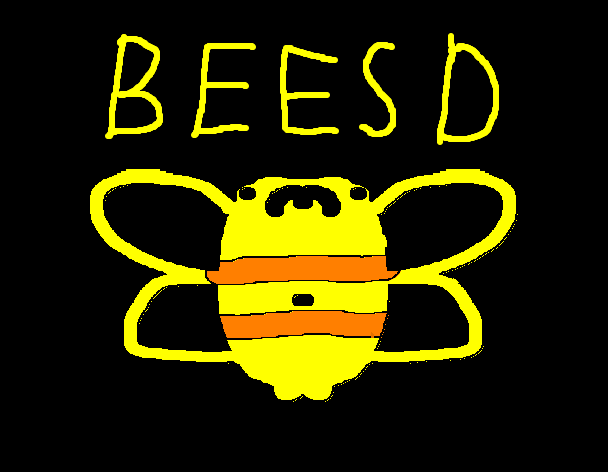

# BEESD

*BEESD* is a bare-metal 32-bit x86 (IA32) executable larping as a standalone kernel, featuring stuff.

## Progress

 - [x] Bootable state
 - [x] VGA output (no scrolling yet)
 - [x] Serial support
 - [x] GDT/TSS
 - [x] IDT and interrupt handling (PIC/PIT)
 - [ ] MISC: Limine bootloader option
 - [x] Keyboard support via PS/2
 - [x] Getting physical memory map
 - [ ] Physical Memory Manager (PMM)
 - [ ] Virtural Memory Manager (VMM), paging and general head shenanigans
 - [ ] Usermode
 - [ ] ...

## Compiling 
### Requirements

 - [Zig](https://ziglang.org/) (tested with the version 0.17.1, I didn't test other versions but can say that you would need version 0.11.* minimum, likely newer)
 - [GNU GRUB](https://www.gnu.org/software/grub/) (optional) - Required for building the ISO image
 - [QEMU](https://www.qemu.org/) (runtime) - Required for running the kernel using `zig build run` (with GRUB as the bootloader) or `zig build run-raw`
 ### Instructions
 Run `zig build` in the project directory, run `zig build -l` to see more options

## Credits
 - [Zig Bare Bones](https://wiki.osdev.org/Zig_Bare_Bones) - The base of the kernel + tty.zig based off this article
 - [Bee ASCII art](https://asciiart.website/art/6264)  by [MrPotatoMan](https://asciiart.website/artist.php?artist_id=735) - Used in `src/kernel.zig`
 - [Pluto Kernel](https://github.com/ZystemOS/pluto) - 99.99% of `src/gdt.zig`, parts of the interrupt code

## Miscellaneous 
### Why is it called BEESD
Cuz, it's funny and bees are cool, also BEESD stands for **B**eautiful **E**gregiously **E**legant **S**oftware **D**istribution
### Is this based on BSD?
No. The kernel is just named similarly because it would be mad funny
### Why Zig?
The previous attempt I made at creating a kernel was written in C, and it was held together by thoughts and prayers because of 17 gazillion different pieces of tooling and compiling the compiler to compile the kernel, so far Zig has freed me from that hell. **TLDR**: Skill issue
